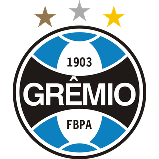

# 🏆 Guia de Geração de Blocos HTML para Resultados de Jogos

Este documento contém todo o conhecimento aprendido sobre como gerar blocos HTML para resultados de jogos de futebol, incluindo mapeamento de times, logos, indicadores e estrutura do código.

---

## 📋 Formato de Input

Você pode fornecer resultados em português:

```
vitoria - Flamengo 2 x 0 Corinthians - Brasileirão
derrota - Corinthians 0 x 1 Grêmio - Copa do Brasil
empate - Vasco 1 x 1 Corinthians - Brasileirão
```

---

## 🏷️ Mapeamento de Termos

| Termo | Indicador HTML | Classe |
|-------|----------------|--------|
| `vitoria` / `vítoria` | → `victory` | `indicator-victory` (verde) |
| `derrota` | → `defeat` | `indicator-defeat` (vermelho) |
| `empate` | → `draw` | `indicator-draw` (amarelo) |

---

## 📁 Estrutura do Bloco HTML

```html
<!-- {RESULTADO} - {Mandante} {Casa}x{Visitante} {Visitante} -->
<div class="matches-row">
    <div class="indicator indicator-{INDICADOR}"></div>
    <div class="row">
        <div class="time-casa">
            <div class="nome-do-time-casa">{NOME_MANDANTE}</div>
            <div class="img-wrapper"></div>
        </div>

        <div class="placar">
            <div class="ponto-casa">{PONTOS_CASA}</div>
            <div class="versus">X</div>
            <div class="ponto-visitante">{PONTOS_VISITANTE}</div>
        </div>

        <div class="time-visitante">
            <div class="img-wrapper"></div>
            <div class="nome-do-time-fora">{NOME_VISITANTE}</div>
        </div>
    </div>
</div>
```

---

## 📂 Mapeamento de Logos (Pasta Única: `./escudos/`)

**⚠️ IMPORTANTE:** Todos os logos estão na pasta **`./escudos/`**. Use apenas este caminho!

| Time | Arquivo do Logo |
|------|-----------------|
| corinthians | `./escudos/corinthians-logo-footylogos-320.webp` |
| flamengo | `./escudos/flamengo-logo-footylogos-320.webp` |
| palmeiras | `./escudos/palmeiras-logo-footylogos-320.webp` |
| sao-paulo | `./escudos/sao-paulo-logo-footylogos-320.webp` |
| gremio | `./escudos/gremio-logo-footylogos-320.webp` |
| vasco-da-gama | `./escudos/vasco-da-gama-logo-footylogos-320.webp` |
| santos-fc | `./escudos/santos-fc-logo-footylogos-320.webp` |
| botafogo | `./escudos/botafogo-logo-footylogos-320.webp` |
| atlético-mineiro | `./escudos/atletico-mineiro-logo-footylogos-320.webp` |
| coritiba | `./escudos/coritiba-logo-footylogos-320.webp` |
| sc-internacional | `./escudos/sc-internacional-logo-footylogos-320.webp` |
| bahia | `./escudos/bahia-logo-footylogos-320.webp` |
| ceara-sc | `./escudos/ceara-sc-logo-footylogos-320.webp` |
| fortaleza | `./escudos/fortaleza-logo-footylogos-320.webp` |
| always-ready | `./escudos/always-ready-logo-footylogos-320.webp` |
| defensa-y-justicia | `./escudos/defensa-y-justicia-logo-footylogos.png` |
| club-libertad | `./escudos/club-libertad-logo-footylogos-320.webp` |
| londrina | `./escudos/londrina-logo-footylogos-320.webp` |
| goias | `./escudos/goias-logo-footylogos-320.webp` |
| cuiaba | `./escudos/cuiaba-logo-footylogos-320.webp` |
| ponte-preta | `./escudos/ponte-preta-logo-footylogos-320.webp` |
| grêmio-novorizontino | `./escudos/gremio-novorizontino-logo-footylogos-320.webp` |

---

## 🎯 Exemplos Práticos

### Exemplo 1: Vitória em Casa

**Input:**
```
vitoria - Corinthians 4 x 1 Ponte Preta - Copa do Brasil
```

**Saída HTML:**
```html
<!-- VITORIA - Corinthians 4x1 Ponte Preta -->
<div class="matches-row">
    <div class="indicator indicator-victory"></div>
    <div class="row">
        <div class="time-casa">
            <div class="nome-do-time-casa">Corinthians</div>
            <div class="img-wrapper"></div>
        </div>

        <div class="placar">
            <div class="ponto-casa">4</div>
            <div class="versus">X</div>
            <div class="ponto-visitante">1</div>
        </div>

        <div class="time-visitante">
            <div class="img-wrapper"></div>
            <div class="nome-do-time-fora">Ponte Preta</div>
        </div>
    </div>
</div>
```

### Exemplo 2: Derrota em Visitante

**Input:**
```
derrota - Corinthians 0 x 1 Grêmio - Copa do Brasil
```

**Saída HTML:**
```html
<!-- DERROTA - Corinthians 0x1 Grêmio -->
<div class="matches-row">
    <div class="indicator indicator-defeat"></div>
    <div class="row">
        <div class="time-casa">
            <div class="nome-do-time-casa">Corinthians</div>
            <div class="img-wrapper"></div>
        </div>

        <div class="placar">
            <div class="ponto-casa">0</div>
            <div class="versus">X</div>
            <div class="ponto-visitante">1</div>
        </div>

        <div class="time-visitante">
            <div class="img-wrapper"></div>
            <div class="nome-do-time-fora">Grêmio</div>
        </div>
    </div>
</div>
```

### Exemplo 3: Empate

**Input:**
```
empate - Vasco 1 x 1 Corinthians - Brasileirão
```

**Saída HTML:**
```html
<!-- EMPATE - Vasco 1x1 Corinthians -->
<div class="matches-row">
    <div class="indicator indicator-draw"></div>
    <div class="row">
        <div class="time-casa">
            <div class="nome-do-time-casa">Vasco</div>
            <div class="img-wrapper"></div>
        </div>

        <div class="placar">
            <div class="ponto-casa">1</div>
            <div class="versus">X</div>
            <div class="ponto-visitante">1</div>
        </div>

        <div class="time-visitante">
            <div class="img-wrapper"></div>
            <div class="nome-do-time-fora">Corinthians</div>
        </div>
    </div>
</div>
```

---

## 🎨 Indicadores Visuais

| Classe | Cor | Uso |
|--------|-----|-----|
| `indicator-victory` | Verde 🟢 | Vitória do time da casa |
| `indicator-defeat` | Vermelho 🔴 | Derrota do time da casa |
| `indicator-draw` | Amarelo 🟡 | Empate |

---

## ⚠️ Regras Importantes

1. **O comentário sempre indica o resultado real** (ex: `<!-- DERROTA -->`) baseado na perspectiva do Corinthians
2. **Times em casa aparecem primeiro** no bloco `<time-casa>`
3. **Logos são carregados automaticamente** da pasta `./escudos/` - não use outras pastas!
4. **Pontos vazios para placares X-X** (empates)

---

## 📝 Dicas Rápidas

- Use `vitoria`, `derrota` ou `empate` em português no input
- O script automaticamente detecta o campeonato (Brasileirão, Copa do Brasil, Libertadores)
- **Todos os logos devem vir da pasta `./escudos/`**
- Se um logo não for encontrado na pasta escudos, verifique se o arquivo existe ou adicione ao mapeamento acima

---

## 🚀 Fluxo de Trabalho

1. **Forneça resultado** no formato: `vitoria - Flamengo 2 x 0 Corinthians - Brasileirão`
2. **Receba bloco HTML** pronto para copiar e colar no `index.html`
3. **Cole o bloco** no local desejado (após o último jogo ou no final do arquivo)
4. **Repita** para cada resultado novo

---

## 📂 Estrutura de Pastas

```
temporada-2029/
├── index.html                    # Arquivo principal com todos os jogos
├── estilos.css                   # Estilos CSS
├── README.md                     # Documentação
├── GUIA-GERACAO-JOGOS.md         # 📚 Este guia de geração
└── escudos/                      # 🖼️ PASTA ÚNICA DE LOGOS (use apenas esta!)
    ├── corinthians-logo-footylogos-320.webp
    ├── flamengo-logo-footylogos-320.webp
    ├── gremio-logo-footylogos-320.webp
    ├── ... (todos os outros logos)
```

---

**Documento criado por:** AI Assistente  
**Data:** 21/10/2026  
**Projeto:** Temporada 2029 - Brasileirão, Copa do Brasil, Libertadores
